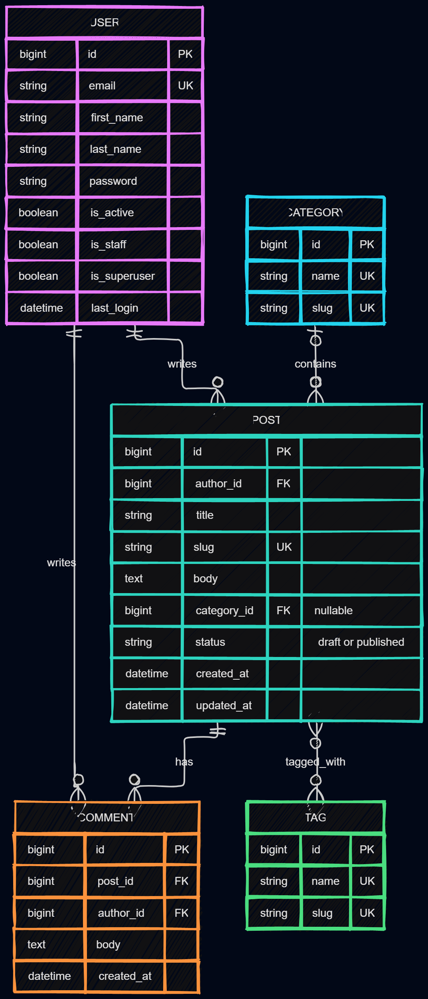
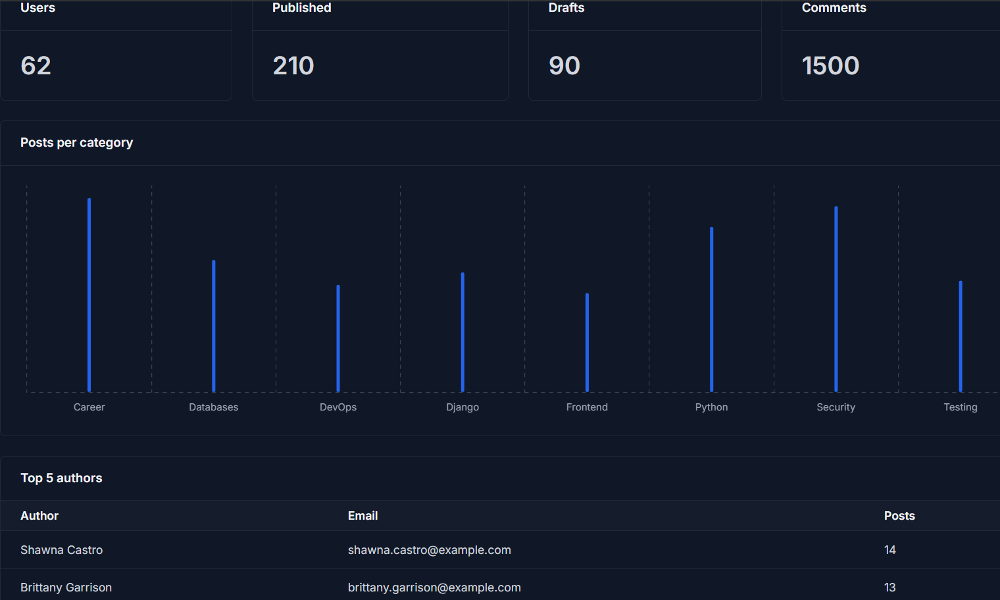
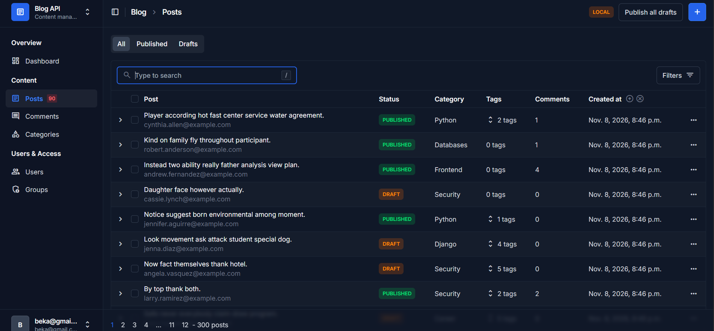
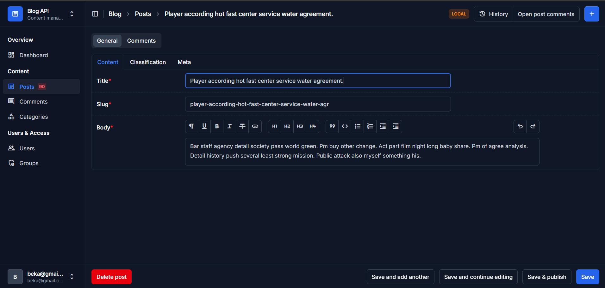
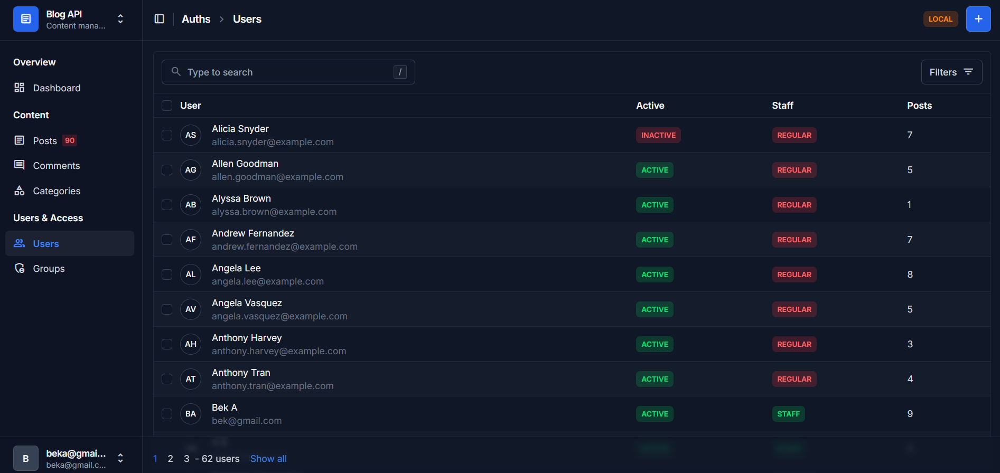

# blog-api
Django Homework 1.
## ERD


## Homework 2 — Seeding and admin

### Seeding

```powershell
python manage.py seed
```

| Argument | Default | Description |
| --- | --- | --- |
| `--users` | `20` | Number of users to create |
| `--posts` | `100` | Number of posts to create |
| `--comments` | `500` | Number of comments to create |
| `--clear` | Off | Delete existing blog data and non-superusers before seeding |

Example:

```powershell
python manage.py seed --users 50 --posts 300 --comments 1500
```

### Admin screenshots






## Homework 3 — Django ORM

The seed command spreads post dates over the last 365 days.
About 30% of posts are edited 1–30 days after creation.
Comment dates are between their post's creation date and now.

### Queries

Run all read queries:

```powershell
python manage.py queries
```

Run one query:

```powershell
python manage.py queries --number 31
```

Show the executed SQL:

```powershell
python manage.py queries --number 6 --sql
```

Queries 40–44 change data and run only when selected with `--number`.

Example output:

```text
#6 has_drafts — 1 SQL query
  True
```

### Run on an empty database

```powershell
python manage.py migrate
python manage.py seed
python manage.py queries
python manage.py queries --number 41
```