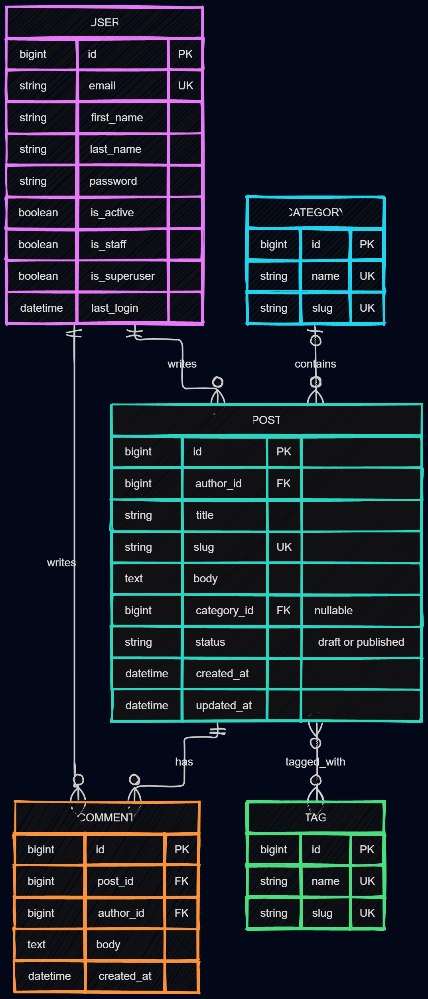
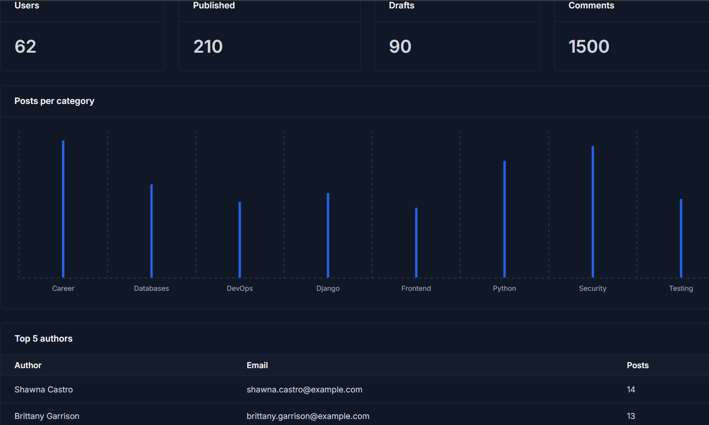
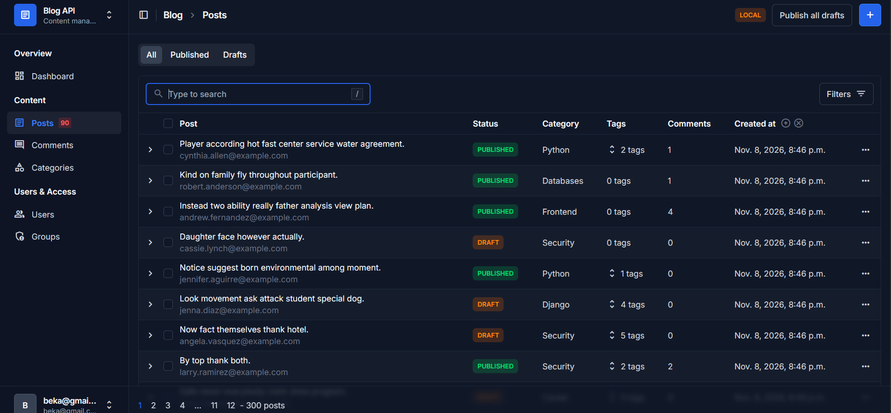
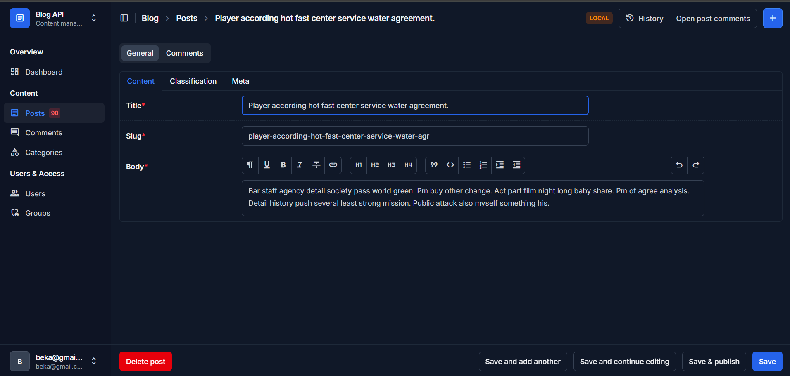
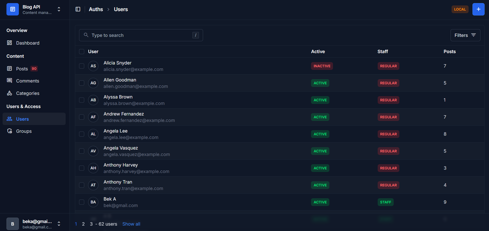

# blog-api
Django Homework 1.
## ERD


## Homework 2 — Seeding and admin

### Seeding

```powershell
python manage.py seed
```

| Argument | Default | Description |
| --- | --- | --- |
| `--users` | `20` | Number of users to create |
| `--posts` | `100` | Number of posts to create |
| `--comments` | `500` | Number of comments to create |
| `--clear` | Off | Delete existing blog data and non-superusers before seeding |

Example:

```powershell
python manage.py seed --users 50 --posts 300 --comments 1500
```

### Admin screenshots




